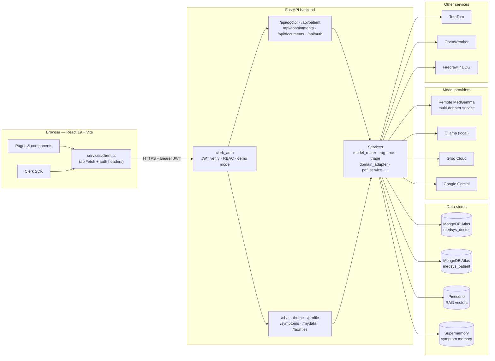
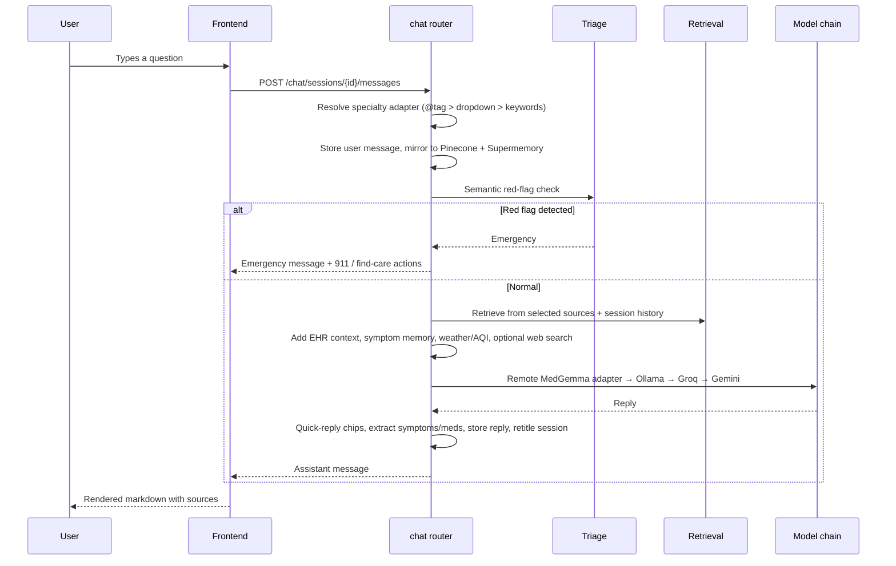

<div align="center">

# MedSysAI

**A role-aware clinical platform where doctors and patients share one living medical record — grounded AI chat, specialty-routed medical models, OCR'd documents, symptom knowledge graphs, and care-finding, all behind real authentication.**


</div>

---

> **Medical disclaimer.** MedSysAI is a software engineering and research project. It is **not** a medical device, is not validated for clinical use, and must not be used to diagnose, treat, or make decisions about real patients. AI output can be wrong. Always consult a qualified clinician.

---

## Table of contents

1. [What is MedSysAI?](#1-what-is-medsysai)
2. [Feature tour](#2-feature-tour)
3. [Architecture](#3-architecture)
4. [Tech stack](#4-tech-stack)
5. [Repository layout](#5-repository-layout)
6. [Quick start](#6-quick-start)
7. [Configuration reference](#7-configuration-reference)
8. [Authentication, roles & demo mode](#8-authentication-roles--demo-mode)
9. [The data model](#9-the-data-model)
10. [The AI layer](#10-the-ai-layer)
11. [API reference](#11-api-reference)
12. [Frontend guide](#12-frontend-guide)
13. [Design system](#13-design-system)
14. [Utility scripts](#14-utility-scripts)
15. [Troubleshooting](#15-troubleshooting)
16. [Known limitations](#16-known-limitations)
17. [Security & privacy notes](#17-security--privacy-notes)
18. [Contributing](#18-contributing)
19. [Further documentation](#19-further-documentation)

---

## 1. What is MedSysAI?

Most health software forces a choice: a patient app that knows nothing about the clinic, or a clinical system the patient never sees. MedSysAI puts **both sides on one record**.

- A **patient** uploads reports, logs medications and meals, chats with an AI companion grounded in *their own* documents, and books appointments.
- A **doctor** gets a command center with a severity-sorted triage queue, a 360° patient workspace, a guided consultation workflow with AI decision support and medication-safety checks, and a copilot that can be scoped to a single patient or kept general.
- Both talk to the same FastAPI backend, which owns all AI orchestration, OCR, retrieval, and storage.

One React app, one API, two portals — chosen at sign-in and enforced on the server, not just hidden in the UI.

### Design principles

| Principle | What it means in practice |
|---|---|
| **Grounded, not generic** | Chat answers retrieve from the documents the user selects (RAG), and cite them. |
| **Role isolation by construction** | Doctor and patient data live in **separate MongoDB databases**. One account is exactly one role. |
| **Graceful degradation** | Every AI call has a fallback chain (local → cloud). Every integration fails soft instead of taking the app down. |
| **Real data only** | Pages render real API data or honest empty states — no fabricated records. |
| **Safety layers** | Emergency red-flag detection short-circuits normal generation and surfaces 911 / find-care actions. |

---

## 2. Feature tour

### 2.1 Patient portal

| Screen | Route | What it does |
|---|---|---|
| **Home** | `/home` | Live system-status banner (Stable / Moderate / Serious) computed from the symptom graph, weather + air-quality card with a contextual tip, an LLM-generated wellness tip, and an interactive **symptom knowledge graph** (hover/select nodes and edges, zoom, search, time-window filter). |
| **Chat — "Ask MedSys"** | `/chat` | Multi-session AI chat grounded on documents you pick. Deep Search (live web), voice input (Whisper), image attach, adapter/specialty routing, emergency detection, quick-reply chips, collapsible source panels. |
| **Find Care** | `/find-care` | TomTom/MapLibre map of hospitals, clinics and diagnostic centers with specialty and type filters, distance sorting, manual "click the map to set location" override, and Google Maps directions. |
| **My Data** | `/mydata` | Document vault. Upload PDFs / images / text; the backend extracts text, writes a structured summary, classifies the document, extracts lab metrics, and indexes it for retrieval. |
| **Profile** | `/profile` | Editable personal details. **History and medications are derived**, never hand-typed lists that go stale — they're assembled from every uploaded document and every chat mention. |
| Medication tracker | `/patient/medications` | Doctor-prescribed medications with dose logging. |
| Diet manager | `/patient/diet` | AI-assisted diet plan and meal logging. |
| Lab reports | `/patient/lab-reports` | Lab-report vault, OCR'd on upload. |
| Appointments | `/patient/appointments` | Request slots and track status. |
| Dashboard | `/patient/dashboard` | Doctor-published advice, prescriptions, consultation PDFs. |

### 2.2 Doctor portal

| Screen | Route | What it does |
|---|---|---|
| **Command Center** | `/doctor/dashboard` | Four KPI cards (patients, today's appointments, pending labs, alerts), a **severity-sorted priority queue** (critical first), and today's appointments. |
| **Patients** | `/doctor/patients` | Assigned-patient directory, search, and "link an existing patient" flow. |
| **Register Patient** | `/doctor/add-patient` | Three-step wizard creating an active patient with conditions, allergies, assignment, and an optional draft consultation. |
| **Patient Workspace** | `/doctor/patient/:id` | Tabbed 360° view: overview, labs & trends, timeline (with AI analysis), pre-consultation brief, what's-new-since-last-visit, evidence trace, AI copilot. |
| **Consultation Suite** | `/doctor/patient/:id/consult` | Five-step guided consultation with AI decision support, medication-safety checking, diet-plan generation, lab orders, and finalization into a downloadable PDF. |
| **Clinical Copilot** | `/doctor/copilot` | The same chat engine in clinician mode — a model/specialty selector, patient-context switcher (general vs. one patient), grounded sources, suggested clinical actions. |
| **Appointments** | `/doctor/appointments` | Queue with pending / confirmed / completed / cancelled filters and accept/decline actions. |
| **Analytics** | `/doctor/analytics` | Panel-level analytics and multi-patient comparison. |
| **Profile** | `/profile` | Doctor identity, credentials, specialization, and practice details. |

### 2.3 Cross-cutting capabilities

- **Specialty routing.** Messages route to a specialty model via an explicit `@tag`, a UI dropdown, or automatic keyword classification.
- **Emergency triage.** A semantic red-flag check (negation-aware: "no chest pain" is *not* flagged) interrupts normal generation with an emergency message and one-click 911 / nearest-ER actions.
- **Consultation PDFs.** Finalized consultations generate branded prescription/summary PDFs (ReportLab) for both doctor and patient.
- **Command palette.** `Ctrl/⌘ + K` jumps to patients and tools.
- **Audit logging.** Sensitive clinical reads and writes are recorded in `audit_logs`.
- **Responsive shell.** Collapsing sidebar rail on laptops, bottom tab bar on mobile, content capped at 1480 px on large monitors.

---

## 3. Architecture



### Request lifecycle: one chat turn



---

## 4. Tech stack

### Frontend

| Concern | Choice |
|---|---|
| Framework | React 19, TypeScript, Vite 8 |
| Styling | Tailwind CSS v4 (`@theme` tokens in `index.css`; no `tailwind.config.js`) |
| Typography | Fraunces (display), Inter (UI), IBM Plex Mono (data) — self-hosted via Fontsource |
| Routing | React Router 7 |
| Auth | `@clerk/clerk-react` |
| Animation | Framer Motion |
| Maps | `@tomtom-org/maps-sdk` + `maplibre-gl` |
| Markdown | `react-markdown` + `remark-gfm` |
| Icons | `lucide-react` |
| Linting | `oxlint` |

### Backend

| Concern | Choice |
|---|---|
| Framework | FastAPI, Uvicorn (Python 3.12+) |
| Database | MongoDB Atlas via `pymongo` (no ODM) — **two isolated databases** |
| Validation | Pydantic v2 |
| Auth | Clerk session JWTs (RS256, JWKS) |
| Vector store | Pinecone (one namespace per user) |
| Documents | `pypdf` / PyMuPDF text extraction, `ReportLab` PDF generation |
| HTTP | `httpx` |
| Web search | DuckDuckGo (`ddgs`) + optional Firecrawl scraping |

### AI & external services

| Service | Role |
|---|---|
| **Remote MedGemma adapter service** | Specialty-routed chat (LoRA adapters on `google/medgemma-4b-it`), served over HTTP |
| **Ollama** | Local models, checked first on the main chat-reply path |
| **Groq Cloud** | Cloud fallback, tool-calling for web-search decisions, Whisper speech-to-text |
| **Google Gemini** | Primary model for triage, quick-reply chips, title generation, graph enrichment, tips |
| **Pinecone** | Retrieval-augmented generation vector store |
| **Supermemory** | Longitudinal symptom/medication memory and chat logging |
| **Firecrawl** | Full-page scraping for Deep Search |
| **TomTom** | Maps and facility search |
| **OpenWeather** | Weather and air quality |

---

## 5. Repository layout

```
MedSysAI/
├── README.md                     ← you are here
├── detailed_readme.md            ← exhaustive engineer-facing reference (read before changing internals)
│
├── backend/
│   ├── run.ps1                   # Windows launcher (uses .venv explicitly)
│   ├── requirements.txt
│   ├── .env.example              # copy to .env and fill in
│   ├── app/
│   │   ├── main.py               # App factory, routers, CORS, static /uploads
│   │   ├── config.py             # Env-driven Settings singleton
│   │   ├── db.py                 # Two-database Mongo access + index/seed bootstrap
│   │   ├── models.py             # Legacy (patient-side) Pydantic models
│   │   ├── models_v2.py          # Clinical-platform Pydantic schemas
│   │   ├── routers/
│   │   │   ├── auth.py           # Account linking, doctor/patient registration, patient wizard
│   │   │   ├── doctor.py         # Command center, workspace, consultations, analytics, copilot
│   │   │   ├── patient.py        # Dashboard, medications, diet, clarification chat
│   │   │   ├── appointments.py   # Availability, requests, queues, actions
│   │   │   ├── documents.py      # Lab-report upload + listing
│   │   │   ├── chat.py           # Sessions, messages, sources, transcription
│   │   │   ├── home.py           # Dashboard snapshot
│   │   │   ├── profile.py        # Patient + doctor profiles
│   │   │   ├── symptoms.py       # Symptom logging
│   │   │   ├── mydata.py         # Document vault
│   │   │   ├── facilities.py     # Find Care
│   │   │   └── health.py         # Liveness + model status
│   │   └── services/
│   │       ├── clerk_auth.py         # JWT verification, RBAC, demo identities
│   │       ├── model_router.py       # Every LLM call and its fallback chain
│   │       ├── domain_adapter.py     # Specialty routing to MedGemma adapters
│   │       ├── rag.py                # Chunking, retrieval, source ingestion
│   │       ├── pinecone_client.py    # Vector store client
│   │       ├── hybrid_db_service.py  # Unified document ingestion pipeline
│   │       ├── ocr.py                # Text extraction
│   │       ├── triage.py             # Semantic red-flag detection (chat)
│   │       ├── emergency_triage.py   # Keyword red-flag detection (portals)
│   │       ├── supermemory_client.py # Symptom memory + knowledge-graph data
│   │       ├── symptom_tracker.py    # Longitudinal memory block for prompts
│   │       ├── ai_graph_builder.py   # Symptom normalization + graph enrichment
│   │       ├── doctor_ai_service.py  # Decision support, medication safety
│   │       ├── patient_context_service.py # EHR context aggregation
│   │       ├── pdf_service.py        # Consultation / prescription PDFs
│   │       ├── facilities_service.py # TomTom POI search
│   │       ├── weather.py            # OpenWeather
│   │       ├── web_search.py         # Deep Search
│   │       ├── quick_options.py      # Quick-reply chips
│   │       ├── audit_service.py      # Audit logging
│   │       └── mock_data.py          # Seed + fallback fixtures
│   └── scripts/                  # Verification, seeding, import/export utilities
│
└── frontend/
    ├── index.html
    ├── vite.config.ts
    └── src/
        ├── App.tsx               # Route table
        ├── index.css             # Design tokens + base layer + utilities
        ├── pages/
        │   ├── Landing.tsx · Home.tsx · Chat.tsx · FindCare.tsx · MyData.tsx · Profile.tsx
        │   ├── auth/             # Role select, login, doctor registration, patient activation, profile setup
        │   ├── doctor/           # Command center, patients, wizard, workspace, consultation, copilot, analytics, appointments
        │   └── patient/          # Dashboard, medications, diet, chat, lab reports, appointments
        ├── components/
        │   ├── layout/           # NavShell (sidebar + mobile tabs)
        │   ├── auth/             # ProtectedLayout (auth + role gate), token bridge
        │   ├── chat/             # Composer, MessageBubble, SessionList, SourcesPanel, ModelIndicator, ...
        │   ├── findcare/ · home/ · mydata/ · profile/
        │   └── CommandPalette.tsx · PageHeader.tsx · ErrorBoundary.tsx · ...
        ├── services/             # Typed API client (client.ts, clinicalService.ts, chat.ts, ...)
        ├── types/index.ts        # Shared TypeScript types
        └── hooks/ · lib/         # Reduced-motion, geo, motion presets, source kinds
```

---

## 6. Quick start

### 6.1 Prerequisites

| Requirement | Notes |
|---|---|
| **Node.js 20+** | Frontend toolchain |
| **Python 3.12+** | Backend |
| **MongoDB** | An [Atlas](https://www.mongodb.com/atlas) free cluster, or a local `mongod` / Docker container |
| **Clerk account** | Free tier is fine. Both frontend and backend need keys from the same Clerk application |
| *Optional* | Ollama (local models), Groq / Gemini API keys, Pinecone, Supermemory, Firecrawl, TomTom, OpenWeather |

> The app starts and is usable with only MongoDB + Clerk configured. Each optional service degrades gracefully when its key is missing.

### 6.2 Clone

```bash
git clone https://github.com/Param031010/MedSys_FINAL.git
cd MedSys_FINAL
```

### 6.3 Backend

```bash
cd backend
python -m venv .venv

# Windows
.venv\Scripts\activate
# macOS / Linux
source .venv/bin/activate

pip install -r requirements.txt
cp .env.example .env        # then edit .env — see §7
```

Run it:

```bash
# Windows (recommended — pins the project's venv)
./run.ps1

# Any OS
python -m uvicorn app.main:app --reload --port 8000
```

The API is now at **http://localhost:8000** with interactive docs at **http://localhost:8000/docs**.

On first start the backend creates all indexes in both databases and — **only if the `doctors` collection is empty** — seeds one sample doctor, three sample patients, and related vitals, labs, alerts and appointments so the UI isn't empty.

### 6.4 Frontend

```bash
cd frontend
npm install
cp .env.example .env.local   # then edit — see §7
npm run dev
```

Open **http://localhost:5173**.

### 6.5 Production build

```bash
cd frontend
npm run build      # type-checks (tsc -b) then builds with Vite
npm run preview    # serve the built bundle locally
```

### 6.6 Optional: local models with Ollama

```bash
ollama pull hf.co/unsloth/medgemma-4b-it-GGUF:Q4_K_M       # chat
ollama pull hf.co/Mungert/medgemma-4b-pt-GGUF:Q4_K_M       # vision
```

Then set `OLLAMA_HOST`, `OLLAMA_MODEL` and `OLLAMA_VISION_MODEL` in `backend/.env`. A 4B model on CPU can take 15–40 s for a first reply while weights load; see [Troubleshooting](#15-troubleshooting).

### 6.7 Frontend without a backend

Leave `VITE_API_BASE_URL` empty and the *original* pages (Home, Find Care, My Data, Profile) run on mock data — handy for UI-only work. The newer doctor/patient portal pages have no mock fixtures and show empty states without a backend.

---

## 7. Configuration reference

### 7.1 Backend — `backend/.env`

`.env` is git-ignored. **Never commit it.** `backend/.env.example` is the template.

| Variable | Required | Default | Purpose |
|---|---|---|---|
| `MONGODB_URI` | **Yes** | `mongodb://localhost:27017` | Connection string (Atlas `mongodb+srv://…` supported). URL-encode special characters in the password (`@` → `%40`). |
| `MONGODB_DOCTOR_DB` | No | `medsys_doctor` | Doctor accounts only |
| `MONGODB_PATIENT_DB` | No | `medsys_patient` | Every patient-owned collection |
| `CLERK_SECRET_KEY` | **Yes** | — | Server-side JWT verification |
| `CLERK_PUBLISHABLE_KEY` | **Yes** | — | Must match the frontend key; the JWT issuer/JWKS host is derived from it |
| `CORS_ORIGINS` | **Yes** | `http://localhost:5173` | Comma-separated allowed origins |
| `MEDSYS_DEMO_MODE` | No | `true` | Unauthenticated requests get an isolated per-browser demo identity. **Set `false` in production.** |
| `OLLAMA_HOST` | No | — | Local model server, e.g. `http://localhost:11434` |
| `OLLAMA_MODEL` | No | — | Chat model. If empty, chat falls back to Groq |
| `OLLAMA_VISION_MODEL` | No | — | Vision model for image inputs |
| `GROQ_API_KEY` | No* | — | Cloud fallback, web-search tool-calling, Whisper |
| `GROQ_MODEL` | No | — | e.g. `openai/gpt-oss-20b` |
| `GEMINI_API_KEY` | No* | — | Primary model for triage, chips, titles, tips |
| `GEMINI_MODEL` | No | `gemini-2.5-flash` | |
| `MEDGEMMA_ADAPTER_URL` | No | — | Remote multi-adapter service for specialty chat |
| `PINECONE_API_KEY` / `PINECONE_INDEX` | No | — | RAG vector store; retrieval is disabled without it |
| `SUPERMEMORY_API_KEY` | No | — | Symptom memory / knowledge graph |
| `SUPERMEMORY_CONTAINER_TAG` | No | `medsys-symptoms` | |
| `SUPERMEMORY_CHAT_CONTAINER_TAG` | No | `medsys-chat` | |
| `FIRECRAWL_API_KEY` | No | — | Full-page scraping for Deep Search |
| `OPENWEATHER_API_KEY` | No | — | Weather and AQI |
| `TOMTOM_API_KEY` | No | — | Live facility search |

\* At least one LLM path (Ollama, Groq, or Gemini) must be reachable for chat to answer.

### 7.2 Frontend — `frontend/.env.local`

| Variable | Required | Purpose |
|---|---|---|
| `VITE_CLERK_PUBLISHABLE_KEY` | **Yes** | Gates the app behind sign-in; must match the backend key |
| `VITE_API_BASE_URL` | No | Backend URL (e.g. `http://localhost:8000`). Empty = mock mode |
| `VITE_TOMTOM_API_KEY` | No | Live map on Find Care; a placeholder map renders without it |

> **Frontend keys are public.** Anything prefixed `VITE_` ships to the browser. Only publishable keys belong there.

---

## 8. Authentication, roles & demo mode

### 8.1 How a request is authenticated

1. The browser signs in through Clerk. `AuthTokenBridge` hands Clerk's `getToken()` to the non-React API client.
2. Every request carries `Authorization: Bearer <JWT>`, plus `X-User-Role` and `X-Demo-Session-Id` headers.
3. The backend verifies the JWT (RS256 against Clerk's JWKS) and resolves the Clerk identity to a **doctor** *or* **patient** record via `get_current_user`.
4. Routes enforce access with `require_role("doctor")` / `get_current_user`. Per-patient doctor routes additionally call `verify_patient_access` so a doctor can only read patients assigned to them.

### 8.2 One account, one role

A Clerk identity resolves to whichever collection has it linked — doctors are checked first. If someone signs in on the *patient* page with an account that is already a doctor (or vice versa), the frontend shows an explicit "This account is already in use" screen instead of rendering the wrong portal. Role-specific routes are also guarded client-side as defense in depth.

### 8.3 First sign-in

A brand-new Clerk account has no linked record, so `ProtectedLayout` shows `ProfileSetup` until registration completes (`POST /api/auth/register-doctor` or `register-patient`).

Patients can also be created by a doctor through the registration wizard (`POST /api/auth/add-patient-wizard`). Such a record is active immediately; when that patient later signs up with the same email, the unclaimed record is **linked** rather than duplicated.

### 8.4 Demo mode

With `MEDSYS_DEMO_MODE=true`, requests with no valid Clerk session receive an auto-provisioned, **isolated** identity keyed by the browser's `X-Demo-Session-Id` — each visitor gets their own sandbox doctor or patient. The login page's "Demo Credentials" shortcut uses this. It exists for demos and local development.

> ⚠️ Turn demo mode **off** for any internet-facing deployment.

---

## 9. The data model

### 9.1 Two databases, never mixed

| Database | Contents |
|---|---|
| `medsys_doctor` | `doctors`, `doctor_profiles` — nothing patient-related is ever written here |
| `medsys_patient` | everything else |

A consultation or appointment still carries a `doctor_id` *reference field*, but the doctor's own account row is never stored beside patient data. Access goes through `get_doctor_db()` / `get_patient_db()`, both backed by one cached `MongoClient`.

### 9.2 `medsys_patient` collections

| Group | Collections |
|---|---|
| Identity & access | `patients`, `doctor_patient` (assignment links), `patient_invitations` |
| Clinical record | `consultations`, `prescriptions`, `vitals`, `patient_conditions`, `allergies` |
| Labs | `lab_reports`, `lab_metrics`, `raw_lab_documents`, `lab_orders` |
| Care plan | `patient_diet`, `diet_plans`, `meal_logs`, `medication_logs` |
| Scheduling & alerts | `appointments`, `alerts` |
| Compliance | `audit_logs` |
| Symptoms & graph | `patient_symptom_history`, `symptoms`, `graph_cache` |
| Chat & RAG | `sources`, chat sessions, chat messages |

`init_collections()` runs on every startup, creates all indexes, and seeds sample data only when `doctors` is empty. A bad Mongo URI therefore fails at **startup**, not on the first request.

---

## 10. The AI layer

### 10.1 Which model does what

| Task | Fallback chain |
|---|---|
| Specialty-routed chat replies | **Remote MedGemma adapter → Ollama → Groq → Gemini** |
| Triage, quick-reply chips, titles, graph enrichment, general tip | **Gemini → Groq** (retries with backoff on 429) |
| Doctor/patient copilot-style completions | **Gemini → (Ollama → Groq → Gemini)** |
| Document text extraction | PyMuPDF text layer / plain-text passthrough |
| Speech-to-text | Groq `whisper-large-v3-turbo` |
| Web-search decision | Groq tool-calling only |
| PDF generation | ReportLab (not an LLM) |

Every chain swallows provider errors and moves to the next. If *all* providers fail, the chat returns a clear "Unable to reach AI backend" message rather than hanging.

### 10.2 Specialty adapters

Chat can route to fine-tuned LoRA adapters on `google/medgemma-4b-it`, served by a remote service (`MEDGEMMA_ADAPTER_URL`). The adapter is picked in priority order:

1. An explicit **`@tag`** in the message (e.g. `@radiology`).
2. The **UI dropdown** (model indicator in the chat header).
3. **Implicit keyword classification** of the message.

Training and test notebooks for the ophthalmology, radiology, and dermatology adapters are documented in `detailed_readme.md` §10.

### 10.3 Retrieval-augmented generation

- Documents are chunked (with overlap) and embedded into Pinecone, **one namespace per user**.
- A chat session retrieves only from the sources the user selected, plus that session's own history and any web results gathered during the turn.
- Deleting a document purges its vectors and removes it from every session's selected sources.

### 10.4 Emergency triage — three independent layers

| Layer | Method | Used by |
|---|---|---|
| `triage.py` | LLM-based, negation- and third-party-aware, with a fast deterministic pre-check | Chat |
| `emergency_triage.py` | Synchronous keyword matching | Doctor/patient portal AI features |
| Doctor alerts | Lab/adherence flags written to `alerts` | Command Center priority queue |

When chat triage fires, normal generation is **skipped**; the user gets an emergency message with 911 and nearest-ER actions.

### 10.5 Document ingestion pipeline

`hybrid_db_service.ingest_unified_medical_document`:

1. Save the file to `backend/uploads/` and expose it at `/uploads/<name>`.
2. Extract text (text layer; vision OCR for scanned PDFs and images).
3. Generate a report summary and classify the document.
4. Extract structured lab metrics into `lab_reports` / `lab_metrics`.
5. Index into Pinecone and `sources` so chat can cite it.

---

## 11. API reference

Interactive docs live at **`/docs`** (Swagger) when the backend runs. Summary:

### 11.1 Health & public

| Method | Path | Notes |
|---|---|---|
| GET | `/health` | Active provider + reachability. No auth |
| GET | `/facilities` | Find Care listings. No auth |

### 11.2 Auth — `/api/auth`

| Method | Path | Purpose |
|---|---|---|
| GET | `/me` | Does this Clerk account have a linked profile, and which role? |
| POST | `/register-patient` | Create or claim a patient record |
| POST | `/register-doctor` | Create a doctor record |
| POST | `/add-patient-wizard` | Doctor-only: create an active patient |

### 11.3 Doctor — `/api/doctor` *(doctor role)*

| Method | Path | Purpose |
|---|---|---|
| GET | `/command-center` | KPIs, priority queue, today's appointments |
| GET | `/patients` · `/patients/search` | Assigned patients, search |
| POST | `/patients/link` | Link an existing patient |
| GET | `/patient/{id}/overview` | 360° overview |
| GET | `/patient/{id}/timeline` · `/timeline-analysis` | Timeline + AI analysis |
| GET | `/patient/{id}/pre-brief` | Pre-consultation brief |
| GET | `/patient/{id}/lab-trends` | Metric trends |
| GET | `/patient/{id}/whats-new` · `/evidence` | Changes since last visit, evidence trace |
| GET | `/patient/{id}/safety-check` | Medication-safety check |
| POST | `/patient/{id}/custom-summary` | Custom history summary |
| POST | `/consultations` | Start a consultation |
| POST | `/consultations/{id}/ai-assist` | AI decision support |
| POST | `/consultations/{id}/finalize` | Finalize + generate PDF |
| GET | `/consultations/{id}/pdf` | Download PDF |
| POST | `/copilot/chat` | Patient-scoped copilot |
| POST | `/generate-diet-plan` · `/lab-orders` · `/voice-parse` | Care-plan tools |
| GET | `/analytics` · `/compare` | Panel analytics, multi-patient compare |

### 11.4 Patient — `/api/patient` *(patient role)*

| Method | Path | Purpose |
|---|---|---|
| GET | `/dashboard` | Doctor-published advice and prescriptions |
| GET | `/medications` · POST `/medications/log` | Medication list, dose logging |
| GET | `/diet` · POST `/diet/meals` | Diet plan, meal logging |
| POST | `/chat` | Clarification assistant |
| GET | `/consultations/{id}/pdf` | Download consultation PDF |

### 11.5 Appointments — `/api/appointments`

| Method | Path | Purpose |
|---|---|---|
| GET | `/availability` | Open slots |
| POST | `/request` | Patient requests a slot |
| GET | `/doctor-queue` · `/patient-queue` | Role-specific queues |
| POST | `/{id}/action` | Accept / decline / complete / cancel |
| GET | `/patient-latest-update` | Latest status for the patient |

### 11.6 Documents & vault

| Method | Path | Purpose |
|---|---|---|
| GET | `/api/documents/lab-reports` | List lab reports |
| POST | `/api/documents/upload` | Upload + OCR a lab report |
| POST | `/mydata/upload` | Upload to the document vault (full ingestion) |
| GET/DELETE | `/chat/sources…` | List, read, delete grounded sources |

### 11.7 Chat — `/chat`

| Method | Path | Purpose |
|---|---|---|
| GET/POST/DELETE | `/sessions` | Session CRUD |
| GET | `/sessions/{id}/messages` | History |
| POST | `/sessions/{id}/messages` | **Send a message** (body: `content`, `deepSearch`, `images`, `specialty`) |
| PUT | `/sessions/{id}/sources` | Select grounding documents |
| POST | `/transcribe` | Speech-to-text |

### 11.8 Home, profile, symptoms

| Method | Path | Purpose |
|---|---|---|
| GET | `/home/snapshot` | Status banner, weather, tips, knowledge graph |
| GET/PUT | `/profile` · `/profile/doctor` | Patient / doctor profile |
| GET/POST/DELETE | `/symptoms` | Log and remove symptoms |

---

## 12. Frontend guide

### 12.1 Routing and guards

`App.tsx` declares public routes (landing, role select, sign-in/up, doctor registration, patient activation) and a protected group rendered inside `ProtectedLayout`, which:

1. Waits for Clerk, then checks `GET /api/auth/me`.
2. Shows `ProfileSetup` for accounts with no linked record.
3. Blocks a role mismatch with an explanatory screen.
4. Redirects doctors away from patient-only paths and vice versa.
5. Remounts the whole shell when the signed-in account changes (`key={userId}`) so no stale data leaks between accounts.

### 12.2 API client

`services/client.ts` exposes `apiFetch` / `apiUpload` / `downloadPdfBlob`, attaching auth headers and throwing a typed `ApiError` carrying the HTTP status and server `detail`. Domain modules (`clinicalService.ts`, `chat.ts`, `mydata.ts`, …) wrap it with typed functions; shared types live in `types/index.ts`.

### 12.3 Chat architecture

One `pages/Chat.tsx` powers both portals (`PatientChat` and `ClinicalCopilot` are thin wrappers). It composes `SessionList`, a message feed (`MessageBubble` + `Markdown`), `Composer`, `SourcesPanel`, and `ModelIndicator`. Doctor mode adds a patient-context switcher.

---

## 13. Design system

The visual identity — warm off-white, deep navy, medical teal, serif headings — is defined entirely in `frontend/src/index.css`.

| Token | Value | Use |
|---|---|---|
| `bg-mist` | `#efede7` | App background |
| `surface-card` | `#f8f7f3` | Cards and panels |
| `ink` | `#1b2430` | Text, primary buttons, active nav |
| `teal-deep` | `#2f6e68` | Accent, links, focus rings |
| `indigo-thread` | `#5b5fef` | Secondary accent |
| `clay-alert` | `#b5502e` | Alerts and destructive actions |
| `stone` | `#7c7568` | Secondary text |
| `hairline` | `#dcd8ce` | Borders |

**Global styling lives in the theme layer**, so changes propagate everywhere:

- A warm, navy-tinted `--shadow-2xs … --shadow-lg` elevation scale overrides Tailwind's defaults.
- A base layer provides heading typography, consistent 150 ms transitions, a press effect on buttons, teal focus rings on fields, and slim themed scrollbars.
- `.surface` and `.surface-hover` utilities are the shared card recipe.
- Fields with the `bg-transparent` class are exempt from the focus ring — keep that class on borderless inputs that sit inside a container which draws its own ring.

---

## 14. Utility scripts

All live in `backend/scripts/` and run from `backend/` with the venv active (`python scripts/<name>.py`).

| Script | Purpose |
|---|---|
| `seed_symptoms.py` | Seed symptom history |
| `export_data.py` / `import_data.py` | Dump and restore collections as JSON |
| `audit_keys_and_services.py` | Check which API keys and external services are reachable |
| `verify_full_system.py` | End-to-end system audit |
| `verify_chat_adapters.py` | Exercise specialty adapter routing |
| `verify_profiles.py`, `verify_fixes.py`, `verify_phase2_fixes.py` | Targeted regression checks |
| `test_pipeline.py`, `test_triage.py`, `test_pdf_export.py`, `test_namespace_isolation.py`, `test_all_phases.py` | Pipeline and isolation tests |

Some scripts predate later refactors; see [Known limitations](#16-known-limitations).

---

## 15. Troubleshooting

| Symptom | Cause | Fix |
|---|---|---|
| Backend crashes at startup with `pymongo … DNS query name does not exist` | Transient DNS failure resolving the Atlas `mongodb+srv` SRV record | Retry; check connectivity. If it persists, confirm the cluster exists and your IP is allowed in Atlas **Network Access** |
| `Authentication failed` from MongoDB | Wrong DB user/password | Re-check credentials; URL-encode special characters (`@` → `%40`) |
| Startup `ImportError` about `jwt` | A different PyPI package named `jwt` shadows PyJWT | Use `backend/run.ps1`, which runs the project's `.venv` explicitly |
| CORS errors in the browser | Origin not allowed | Add the exact origin (scheme + host + port) to `CORS_ORIGINS`. `localhost` and `127.0.0.1` are different origins |
| Chat is slow or shows "Unable to reach AI backend" | The local Ollama model is cold-loading (30 s limit) or no provider is reachable | Wait for first load; run `ollama ps`; verify with `scripts/audit_keys_and_services.py`; ensure a Groq or Gemini key is set as fallback |
| Find Care shows a placeholder map | No `VITE_TOMTOM_API_KEY` | Add the key to `frontend/.env.local` and restart Vite |
| Pages show empty states with no backend | `VITE_API_BASE_URL` unset (mock mode) | Set it to the backend URL |
| Styles look stale after an update | Cached CSS | Hard-refresh (Ctrl + Shift + R) |

---

## 16. Known limitations

Documented honestly so nobody is surprised. Full detail and reproduction notes are in `detailed_readme.md` §11.

- **Images are not OCR'd on the vault upload path** unless the vision path is wired in; scanned PDFs and photos may yield placeholder text depending on the build.
- **Some adapters are declared but not trained** — several of the eight canonical specialties have no real fine-tuned model behind the remote service yet.
- **Appointment slot matching** has known edge-case bugs for many time slots.
- **Lab reference ranges** — parsed metrics may fall back to a default range rather than a per-analyte one.
- **A few endpoints are stubs** (voice-note parsing, write-only lab orders).
- **Several utility scripts are out of date** relative to the latest schema changes.
- **Self-registered patients are assigned to every doctor** in the system by design for demo visibility — not suitable for a real multi-clinic deployment as-is.

---

## 17. Security & privacy notes

- **Secrets stay out of git.** `.env`, `.env.local`, and `backend/.venv` are ignored. Only `.env.example` is committed.
- **Never put secrets in `VITE_*` variables** — they are bundled into the browser.
- **Disable demo mode in production** (`MEDSYS_DEMO_MODE=false`).
- **Restrict Atlas network access** to known IPs rather than `0.0.0.0/0` outside local development.
- **Rotate any credential that has been pasted into a chat, issue, or commit.**
- **Uploaded medical documents** are stored under `backend/uploads/` and served statically. Treat that directory as sensitive; it should not be committed or publicly exposed in a real deployment.
- **Data separation** between doctors and patients is enforced at the database level (two databases) and at the route level (`require_role`, `verify_patient_access`).
- This project is **not HIPAA/GDPR-certified.** Do not store real patient data in it.

---

## 18. Contributing

1. Create a feature branch from `main`.
2. Keep backend and frontend changes in separate commits where practical.
3. Type-check and build the frontend before pushing: `cd frontend && npm run build`.
4. Update `detailed_readme.md` in the same change whenever you add, remove, or rename a route, model field, env var, or service.
5. Do not commit `.env` files, database dumps, uploaded documents, or model weights.

---

## 19. Further documentation

- **[`detailed_readme.md`](detailed_readme.md)** — the exhaustive, file-by-file engineering reference: every module and function, data-model details, the LLM fallback chains, the fine-tuning notebooks, design gotchas, and a confirmed-bugs list. Start there before changing internals.
- **Interactive API docs** — run the backend and open `/docs`.

---

<div align="center">

Built with FastAPI, React, MongoDB, and a lot of care about not trusting an AI answer blindly.

</div>
